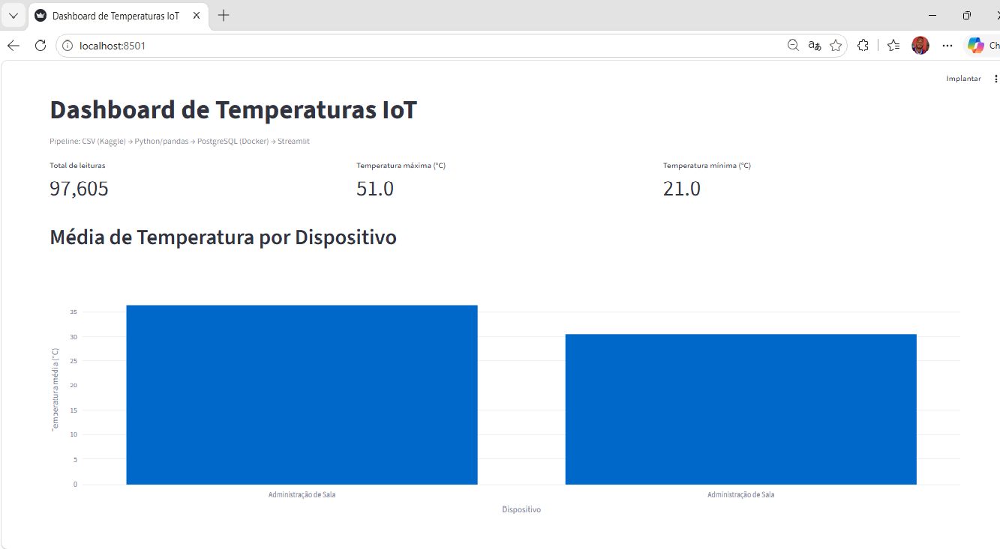
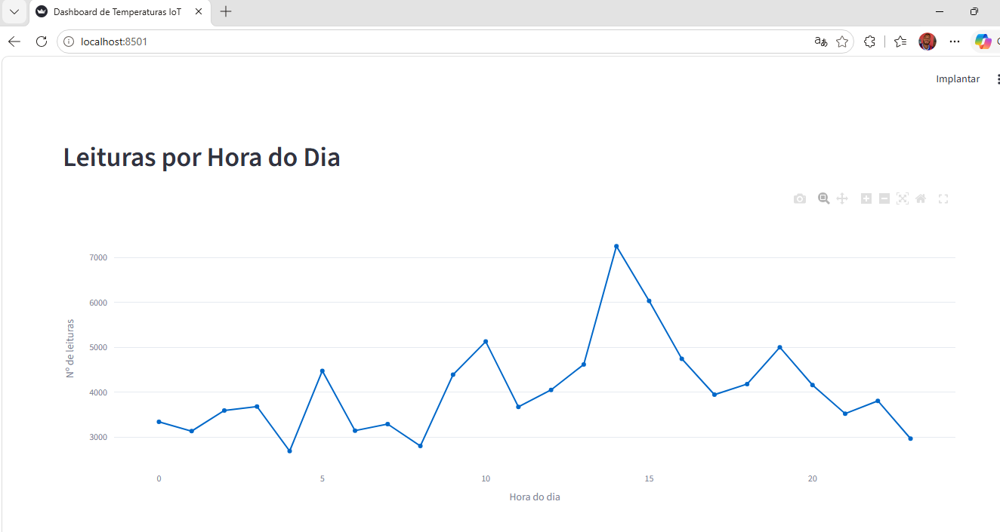
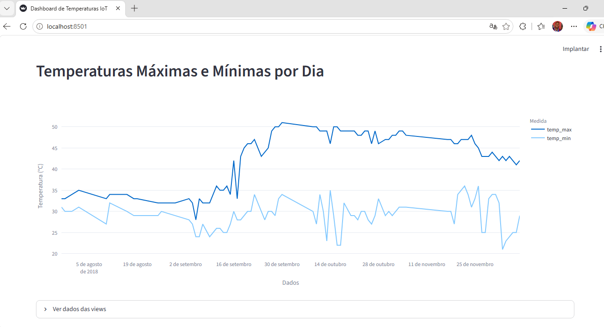

# Pipeline de Dados com IoT e Docker

Pipeline de dados que lê leituras de temperatura de dispositivos IoT (dataset do Kaggle), armazena em **PostgreSQL rodando no Docker**, expõe **3 views SQL** e visualiza tudo em um **dashboard Streamlit**.

Trabalho da disciplina **Disruptive Architectures: IoT, Big Data e IA** — UniFECAF.

## Tecnologias

| Tecnologia | Papel no projeto |
|---|---|
| Python + pandas | Leitura, limpeza e transformação do CSV |
| SQLAlchemy + psycopg2 | Conexão e carga no PostgreSQL |
| Docker / Docker Compose | PostgreSQL isolado e reproduzível |
| PostgreSQL | Armazenamento e views analíticas |
| Streamlit + Plotly | Dashboard com gráficos interativos |
| Git / GitHub | Versionamento e entrega |

## Arquitetura

```
CSV (Kaggle) ──> src/ingest.py ──> PostgreSQL (Docker) ──> 3 views SQL ──> src/dashboard.py (Streamlit)
```

## Estrutura do repositório

```
.
├── docker-compose.yml      # PostgreSQL no Docker (cria tabela e views no 1º start)
├── requirements.txt        # dependências Python
├── .env.example            # variáveis de conexão (opcional)
├── data/                   # CSV do Kaggle (ver data/README.md)
├── sql/
│   ├── 01_schema.sql       # tabela temperature_readings
│   └── 02_views.sql        # as 3 views SQL
├── src/
│   ├── config.py           # conexão com o banco
│   ├── ingest.py           # pipeline CSV -> PostgreSQL
│   └── dashboard.py        # dashboard Streamlit
└── docs/screenshots/       # capturas de tela do dashboard
```

## Pré-requisitos

- Python 3.10+
- Docker (com Docker Compose)
- Git
- Conta no Kaggle (para baixar o CSV)

## Como executar

### 1. Clonar o repositório

```bash
git clone URL_DO_SEU_REPOSITORIO
cd iot-pipeline-docker
```

### 2. Baixar a base de dados

Baixe o dataset **Temperature Readings: IoT Devices** no Kaggle
(https://www.kaggle.com/datasets/atulanandjha/temperature-readings-iot-devices)
e salve o arquivo como `data/IOT-temp.csv`. Detalhes em [`data/README.md`](data/README.md).

### 3. Subir o PostgreSQL com Docker

```bash
docker compose up -d
docker compose ps        # aguarde o status "healthy"
```

Credenciais padrão: usuário `iot_user`, senha `iot_pass`, banco `iot_db`, porta `5432`
(podem ser alteradas copiando `.env.example` para `.env`).

> Alternativa sem Compose (comando do enunciado):
> ```bash
> docker run --name postgres-iot -e POSTGRES_USER=iot_user -e POSTGRES_PASSWORD=iot_pass \
>   -e POSTGRES_DB=iot_db -p 5432:5432 -d postgres
> ```
> Nesse caso a tabela e as views são criadas automaticamente pelo `ingest.py`.

### 4. Criar o ambiente virtual e instalar dependências

```bash
python -m venv venv
source venv/bin/activate          # Windows: venv\Scripts\activate
pip install -r requirements.txt
```

### 5. Executar o pipeline de ingestão

```bash
python src/ingest.py
```

O script lê o CSV, limpa os dados, carrega no PostgreSQL e valida a inserção (contagem de linhas na tabela e nas views).

### 6. Verificar os dados no PostgreSQL

```bash
docker exec -it postgres-iot psql -U iot_user -d iot_db -c "SELECT COUNT(*) FROM temperature_readings;"
docker exec -it postgres-iot psql -U iot_user -d iot_db -c "SELECT * FROM avg_temp_por_dispositivo;"
```

### 7. Rodar o dashboard

```bash
streamlit run src/dashboard.py
```

Acesse http://localhost:8501.

## Views SQL

Definidas em [`sql/02_views.sql`](sql/02_views.sql).

| View | O que faz | Propósito |
|---|---|---|
| `avg_temp_por_dispositivo` | Média, mínimo, máximo e total de leituras por dispositivo | Comparar o comportamento dos sensores interno (`In`) e externo (`Out`) |
| `leituras_por_hora` | Contagem de leituras por hora do dia (0–23) | Entender a distribuição temporal da coleta e detectar lacunas |
| `temp_max_min_por_dia` | Temperatura máxima e mínima por dia | Acompanhar a série temporal e identificar picos e vales |

## Capturas de tela do dashboard

> Adicione as imagens em `docs/screenshots/` e mantenha os nomes abaixo.





## Insights

Os insights obtidos a partir dos dados estão descritos no PDF de documentação entregue com o trabalho
e podem ser verificados diretamente nos gráficos do dashboard e nas views.

## Comandos Git utilizados

```bash
git config --global user.name "Seu Nome"
git config --global user.email "seu.email@exemplo.com"

git init
git add .
git commit -m "Projeto inicial: Pipeline de Dados IoT"
git branch -M main
git remote add origin URL_DO_SEU_REPOSITORIO
git push -u origin main

git pull        # atualizar o repositório local com mudanças do remoto
```

## Parar e limpar o ambiente

```bash
docker compose down          # para o contêiner (mantém os dados)
docker compose down -v       # para e apaga o volume de dados
```

## Autor

Seu Nome — UniFECAF
